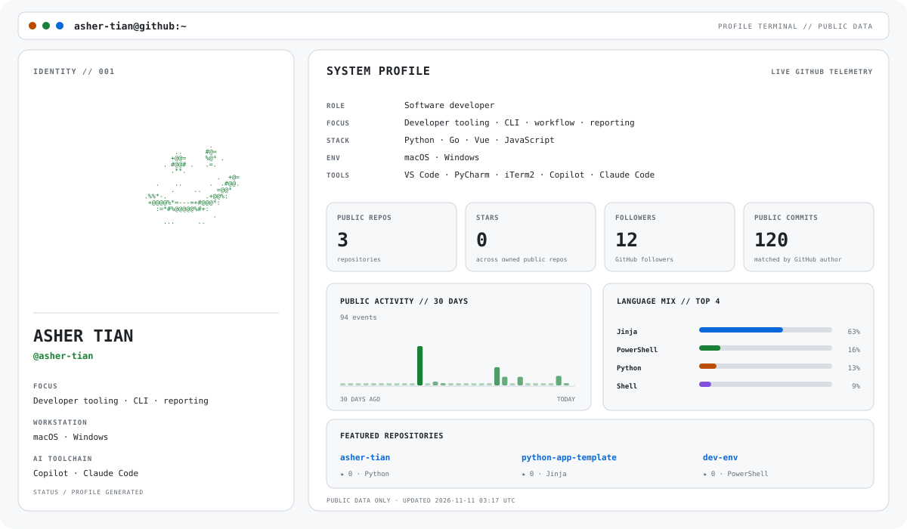

  <picture>
    <source
      media="(prefers-color-scheme: dark)"
      srcset="https://raw.githubusercontent.com/asher-tian/asher-tian/main/dark_mode.svg"
    />
    
  </picture>

  Python · Go · Vue · Developer tooling · Workflow & reporting

  Dashboard uses public GitHub data only · Automatically refreshed daily

